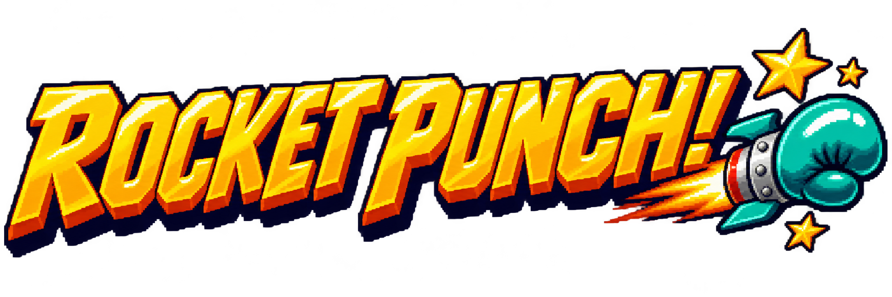

<p align="center">
  
</p>

# Rocket Punch!

A buildless 2D arcade boxing game made for the browser — built by a kids' game jam team with an AI helper. Launch your boxer's whole glove across the ring like a rocket using **webcam motion controls** or a **keyboard**, battle through a **5-level single-player ladder**, or face off in **local 2-player** mode.

**Play now:** **[https://europa-hackathons.github.io/harleys-team/](https://europa-hackathons.github.io/harleys-team/)**

---

## How the Game Works

- **Rocket hands:** Every punch fires your boxer's detached glove straight across the ring, then jets back and locks onto the wrist cuff.
- **High vs. low hits:** Normal fighters start with **1000 HP**. A **head (high)** punch deals **100 damage** and can be dodged by **ducking**; a **body (low)** punch deals **50 damage** and hits underneath a duck or guard. (Zeus's thunder punches deal **150 damage** high or low and break through guard.)
- **SUPER specials:** Dealing normal damage fills your **SUPER** meter (full at **300 damage**). Once it flashes **SUPER READY!**, your next punch unleashes your fighter's elemental special.
- **Sumo finish:** When a boxer hits 0 HP — or the 1-player round timer expires — a cartoon sumo wrestler whistles down from the sky, belly-flops onto the loser (`FLOMP!`), hops off, and waves before the match stats appear. Press any key or click after the drop starts to skip ahead.

---

## Game Modes

### 2 Players (Local — Default)

- **Shared screen & shared camera:** Play side by side in front of one webcam (**P1** on the left, **P2** on the right) or share one keyboard.
- **Character wheel (no duplicates):** P1 spins the boxer wheel first, then P2 spins. P1's fighter is greyed out and crossed out on P2's wheel so both players always get different boxers.
- **Random arena reveal:** A slot-machine roll (`WHERE WILL YOU FIGHT?`) picks randomly from all **6 arenas**, including **The Cliffside** (exclusive to 2-player mode).
- **Fight to the knockout:** Both boxers start with **1000 HP**, full SUPER meters, and no round timer — first to 0 HP loses.

### 1 Player (5-Level Arcade Ladder)

Spin the wheel once for your fighter, then battle through **5 progressively harder stages** against the computer. Your 1000 HP refills after each win, and your run stats (damage, hits, head/body hits, specials) accumulate across all 5 levels. If a stage's default opponent matches your wheel pick, another regular fighter steps in automatically.

- **Opponent behavior:** Computer fighters hold their spot in the ring, raise and lower their **guard** (bouncing normal head punches off with `BOING!`), and fire rocket punches back — even while wobbling, their attack clock keeps ticking. Before every punch, a flashing **`!`** appears over the opponent (and **`DUCK!`** over you for high punches) so you can dodge in time. From Level 2 onward, opponents also charge SUPER meters and mix in quick high/low **combos** (though they hold fire while you are tangled by Ivy).
- **Round timer:** Beat the opponent before the clock hits zero, or the sumo drops on you for **GAME OVER**. Beat Level 5 to become **CHAMPION!**

| Level | Arena | Default Opponent | Opponent HP | Timer | What Changes |
| :---: | :--- | :--- | :---: | :---: | :--- |
| 1 | Arena | Orange | 600 | 75 s | Gentle pace, no combos, no opponent SUPER |
| 2 | The Apartment | Green (Ivy) | 800 | 80 s | Opponent SUPER enabled, occasional combos |
| 3 | The Jungle | Purple (Poison) | 1000 | 90 s | Faster punches, longer guard, more combos |
| 4 | The Volcano | Teal | 1200 | 100 s | Heavy pressure, frequent high punches & combos |
| 5 (Boss) | Outer Space | **Kang** (Boss) | 1500 | 120 s | Fastest attacks, toughest guard, **WIND STORM** special |

> **6th Arena:** **The Cliffside** joins the random arena rotation in **2-Player** mode.

---

## Controls

### Keyboard Controls

| Action | 1 Player | 2 Players — P1 (Left) | 2 Players — P2 (Right) |
| :--- | :--- | :--- | :--- |
| **Walk left / right** | `A` / `D` or `←` / `→` | `A` / `D` | `←` / `→` |
| **High punch (Head — 100 dmg)** | `W` or `↑` | `W` | `↑` |
| **Low punch (Body — 50 dmg)** | `Space`, `S`, or `↓` | `S` | `↓` |
| **Duck (dodge high punches)** | `X`, `Left Shift`, or `Right Shift` | `X` | `Right Shift` or `/` (`-` on Swedish keyboards) |
| **Mute / unmute all sound** | `M` | `M` | `M` |
| **Spin wheel / continue / skip** | `Space`, `Enter`, click, or punch key | `Space`, `Enter`, click, or active player's punch key | `Space`, `Enter`, click, or active player's punch key |

- **Holding duck:** Tapping a duck key crouches for 1 second; **holding** it keeps your boxer down until you release it (unless hit or tangled by Ivy).
- **Skip Sumo finish:** Any key or click/tap (after 0.6 s).

### Webcam Motion Controls

Rocket Punch! uses lightweight local frame-differencing (`src/kit/webcam.js` & `src/game/punch-cam.js`) — **video only, no external tracking libraries, and nothing is recorded or uploaded**.

1. **Permission & secure page:** Clicking **2 PLAYERS** or **1 PLAYER** asks for camera permission. Click **Allow** in your browser, or click **Play with keys instead** (or press `Enter`) to skip the camera. Browsers only allow webcam access on `https://` pages (like GitHub Pages) or `http://localhost`.
2. **Where to stand (mirrored view):**
   - **2 Players:** Stand side by side at the **outer edges** of the camera frame — **P1 on the left**, **P2 on the right**, split by a yellow center divider. Punch **inward** toward the yellow center line.
   - **1 Player:** Stand near the **left edge** of the frame and punch **to the right**.
3. **GET READY positioning:** Before each camera fight, a large mirrored preview shows each player's **`STAND HERE`** box. Step into your box until it turns **green with a ✅**. Once every box stays green for 1 second, the match starts automatically (or press `Space` / click to start right away).
4. **How actions & calibration work during fights:**
   - **Walk:** Shifting sideways inside your **`STAND`** box smoothly slides your boxer across your half of the ring (with smoothing, a dead zone, and a short pause after punches/ducks).
   - **Punch High / Low:** Thrust a fist into your **`HIGH` (`HEAD`)** or **`LOW` (`BODY`)** box. Each box continuously adapts to its resting background motion, requires one box to stand out over the other (so moving your whole body doesn't misfire), ignores sudden whole-frame lighting flashes, and uses a 0.6 s punch cooldown.
   - **Duck:** Crouch quickly so your head and shoulders drop into the dashed **`⬇️ DUCK`** box at the bottom of your stand area. The tracker ignores the bottom 30% (foot shuffling), adapts to steady leg motion, and checks that lower motion exceeds upper-body motion so walking doesn't trigger false ducks (1.0 s duck hold, 0.9 s cooldown).
   - **Hands-free menus:** You can also throw a camera punch to spin the wheel, skip the 2-player arena reveal, and start the next 1-player stage.

### Audio, Mobile Browsers & Language

- **Sound defaults ON:** The small **`🔊` / `🔇`** speaker button in the **bottom-right corner of the title screen** starts enabled. Because desktop and mobile browsers block audio until the first user gesture, music and effects wake up on your first tap, click, or key press. Tapping the speaker button unlocks audio and toggles mute (including on the very first tap — later interactions won't undo your choice). Press **`M`** anywhere to toggle mute.
- **Language toggle:** Click **`🇸🇪 Svenska` / `🇬🇧 English`** on the title screen to switch all menus, fighter and arena names, camera labels, combat pop-ups, and score cards between English and Swedish (remembered in `localStorage`).
- **Mobile note:** Title menus, wheel spins, audio unlock, and webcam play work in mobile browsers (and the title layout adapts to narrow portrait and landscape phones), but **there are no on-screen touch fighting buttons** — fighting requires a webcam or a physical keyboard.

---

## Fighters & Elemental Powers

Five fighters appear on the character wheel; **Kang** appears exclusively as the Level 5 Boss in 1-player mode.

| Fighter | Wheel Odds | Character | SUPER Special (at 300 dmg) | Special Effect |
| :--- | :---: | :--- | :--- | :--- |
| **Teal** (`TURKOS`) | 22.5% | Wave-haired water boxer with watery gloves | **WATER FIST!** (`SLOW!`) | Soaks opponent for **3 s**: slower walking (45%), slower gloves (60%), and a 0.6 s cooldown between punches |
| **Orange** (`ORANGE`) | 22.5% | Flame-haired fire boxer with blazing gloves | **FLAME FIST!** (`MEGA BURN!`) | Double-size rocket fist dealing **+50 bonus damage** plus glowing **lava** splats burning **5 HP/s for 5 s** (won't KO below 1 HP) |
| **Green** (`GRÖN`) | 22.5% | Ivy boxer — Black girl with braided sides, natural afro puff, ivy crown & vine-wrapped gloves | **IVY FIST!** (`TANGLED!`) | Trailing vine glove that wraps the opponent's legs for **2 s** so they **cannot duck** |
| **Purple** (`LILA`) | 22.5% | Poison boxer — girl with high violet ponytail, gold-trimmed alchemist coat & bubbling green poison gloves | **POISON FIST!** (`POISONED!`) | Turns the opponent purple with rising bubbles, dealing **20 HP/s for 5 s** (won't KO below 1 HP — a punch must finish them) |
| **Zeus** (`ZEUS`) | **10% (Rare)** | Greek thunder god with white hair & beard, gold laurel wreath, white/gold Greek drapery & lightning gloves | **THUNDER STORM!** (`STORM!`) | Normal fists already hit for **150 thunder damage** (breaking guard); special drops **3 sky lightning bolts** (`90 + 80 + 80 = 250` damage) |
| **Kang** (`KANG`) | Boss only (Level 5) | Masked dark-navy wind ninja with a flowing bright orange scarf | **WIND STORM!** (`BLOWN AWAY!`) | Double-size swirling wind glove dealing **200 damage** (still dodgeable by ducking when aimed high) |

---

## Music & Sound Effects

- **Title & menu music:** Opens with a one-time intro sting (`assets/audio/music-intro.mp3`) that flows on the beat into the looping title theme (`assets/audio/music-title.mp3`), continuing through the camera, wheel, and place-reveal screens.
- **Stage music:** Crossfades into a dedicated looping track for each arena (`music-arena`, `music-apartment`, `music-jungle`, `music-volcano`, `music-space`; **The Cliffside** uses `music-arena`) and fades out on end screens.
- **Effects:** Dedicated MP3 cues for every elemental special (`special-*.mp3`) and `super-ready.mp3`, combined with Web Audio synthesized arcade effects (`src/game/sfx.js`) for punches, whooshes, boings, thunder, bells, wheel clicks, and the sumo finish.

---

## Run Locally & Verify

No build step, no `npm install`, no backend, and **no API keys or external services are required to play** — the game runs as plain static HTML, CSS, and JavaScript modules with all artwork and audio included in the repo.

```bash
# Serve locally with caching disabled (opens at http://localhost:8000)
python tools/serve.py

# Use another port if 8000 is busy
python tools/serve.py 8010

# Run fast static code checks (ES module syntax via Node if installed + project checks)
python tools/check.py

# Check local machine capabilities (Python, headless browser, ports, optional tools)
python tools/doctor.py
```

> Use a local HTTP server (such as `tools/serve.py`) rather than opening `index.html` directly over `file://`, so ES modules and `http://localhost` webcam permissions work properly.

**Handy testing shortcuts:**
- `?level=3` (or `1`–`5`) starts 1-player mode at that level.
- `?zeus=1` (or holding `Z` while spinning the wheel) guarantees landing on **Zeus**.
- Open `http://localhost:8000/tools/webcam-test.html` to test your webcam and mic outside the game.

**Optional authoring tools (not needed to play):** `tools/elevenlabs_audio.py` (audio) and `tools/tripo_model.py` (3D models) are optional authoring helpers available in the repo for generating assets with personal API keys. All finished sprites, backgrounds, and MP3s used by the game are already checked into `assets/`.

---

## Project Structure & Docs

```text
index.html                  Entry page, screens, audio/language UI, static import map
src/
  main.js                   Game loop, modes, controls, combat rules, HUD, camera glue
  style.css                 Responsive arcade UI layout (desktop + mobile portrait/landscape)
  game/
    levels.js               1-player 5-stage progression, timers, AI difficulty tuning
    roster.js               Boxer roster, wheel odds, HD/pixel-art pose assembly
    specials.js             SUPER meter rules, elemental specials, visual effects
    punch-cam.js            Mirrored 1P/2P stand, punch, and duck motion tracking
    places.js               6 arenas (HD backgrounds + pixel/code fallbacks)
    wheel.js                Spinning character wheel & reveal screen
    sumo-finish.js          End-of-match cartoon sumo sequence
    i18n.js                 English / Swedish localization
    art.js, hd.js, ...      Sprite/atlas loaders, poses, effects, synth SFX, QA helpers
  kit/                      Reusable buildless game modules (input, loop, sound, webcam, etc.)
assets/
  art/hd/                   HD pixel-art fighters, 6 arenas, elemental effects, title logo & wheel rim
  art/                      Original pixel-art sheets & fallbacks
  audio/                    Title/stage MP3 music tracks and elemental special sound effects
tools/                      Local dev server (serve.py), code checks (check.py), browser checks (shot.py, live.py)
docs/                       Game plan, architecture decisions, and game-jam agent playbooks
```

**Tech notes:** Rocket Punch! renders on a 2D HTML5 Canvas (256×144 game logic scaled to native resolution for sharp HD pixel art), uses the Web Audio API for music/SFX, and uses `navigator.mediaDevices.getUserMedia` for webcam play. `index.html` keeps the starter kit's pinned `three@0.170.0` CDN import map ([ADR 0002](docs/adr/0002-no-build-static-site.md)), though Rocket Punch! itself is 2D and does not depend on Three.js at runtime.

**Useful docs:**
- [Game Plan](docs/game-plan.md) — living design notes and jam history (note: includes wish-list ideas beyond what shipped).
- [Kit README](src/kit/README.md) — reusable starter modules in `src/kit/`.
- [ADR 0002: No-build static site](docs/adr/0002-no-build-static-site.md) — why the project stays plain HTML/CSS/JS.
- [Webcam Notes](docs/agents/webcam.md) — camera guidelines and testing page.
- [Glossary](GLOSSARY.md) — Kids' Game Jam vocabulary.

### Using This Repo for Your Own Kids' Game Jam

This repository also contains the agent playbooks used to run the session. To host your own jam, clone into your own copy, open it in your AI coding agent, and point it at [AGENTS.md](AGENTS.md) — it will detect a non-team machine and walk through [docs/agents/setup.md](docs/agents/setup.md) and [docs/agents/environment.md](docs/agents/environment.md). Please do not push to or file issues on the original team's repository.

## Credits

Created by: Gregor, Maxwell, and Elian under Ben's supervision